  

  
  
  

---

### Sobre mim

Sou formado em Sistemas de Informação, com base em **análise de dados**. Hoje aplico **IA generativa** para resolver problemas reais de negócio: crio **agentes e assistentes com Claude**, automatizo rotinas que tomam horas da equipe e conecto sistemas para que os dados trabalhem sozinhos.

Tenho experiência prática com **automação de processos de RH**, onde desenvolvi soluções para:

- **Relatórios e indicadores** de gestão de pessoas
- **Documentos institucionais** padronizados e gerados de forma automatizada
- **Avaliação de desempenho** com feedback estruturado
- **Roteiros de entrevista** para processos de contratação

> Gosto de transformar processos manuais em fluxos simples, confiáveis e documentados.

### O que eu construo

<table>
  <tr>
    <td width="50%" valign="top">
      <b>Agentes e assistentes de IA</b> 
      Assistentes com Claude treinados no contexto da empresa, com skills, ferramentas e integrações via MCP.
    </td>
    <td width="50%" valign="top">
      <b>Automação de processos</b> 
      Scripts e fluxos que eliminam tarefas repetitivas: relatórios, planilhas, e-mails, arquivos e rotinas administrativas.
    </td>
  </tr>
  <tr>
    <td width="50%" valign="top">
      <b>Integrações e APIs</b> 
      Conexão entre sistemas, Google Workspace, APIs REST, OAuth2 e coleta de dados na web.
    </td>
    <td width="50%" valign="top">
      <b>Dados e análise</b> 
      Pipelines, tratamento e visualização de dados para apoiar decisões com Python, SQL e Power BI.
    </td>
  </tr>
</table>

### Stack

**IA e automação** 

**Linguagens e dados** 

**Cloud e infraestrutura** 

### Projetos em destaque

<table>
  <tr>
    <td width="50%" valign="top">
      <a href="https://github.com/tdlima/gdrive-safe-downloader"><b>gdrive-safe-downloader</b></a> 
      Download seguro e retomável do Google Drive pelo terminal, com verificação de integridade, histórico e sincronização de pastas. 
      <code>Python</code> <code>OAuth2</code> <code>CLI</code> <code>automação</code>
    </td>
    <td width="50%" valign="top">
      <a href="https://github.com/tdlima/podcastIA"><b>podcastIA</b></a> 
      Criação de um podcast de ponta a ponta usando ferramentas de IA generativa. 
      <code>IA generativa</code> <code>conteúdo</code>
    </td>
  </tr>
  <tr>
    <td width="50%" valign="top">
      <a href="https://github.com/tdlima/webScrapingMercadolivre"><b>webScrapingMercadolivre</b></a> 
      Coleta automatizada de dados de produtos na web para análise. 
      <code>Python</code> <code>web scraping</code>
    </td>
    <td width="50%" valign="top">
      <a href="https://github.com/tdlima/Projetos_em_Dados"><b>Projetos_em_Dados</b></a> 
      Coleção de projetos de análise e engenharia de dados. 
      <code>Python</code> <code>Pandas</code> <code>SQL</code>
    </td>
  </tr>
</table>

<a href="https://github.com/tdlima?tab=repositories">ver todos os repositórios →</a>

---

  Tem um processo que poderia rodar sozinho? <a href="https://www.linkedin.com/in/jr-lima/">Vamos conversar.</a>

